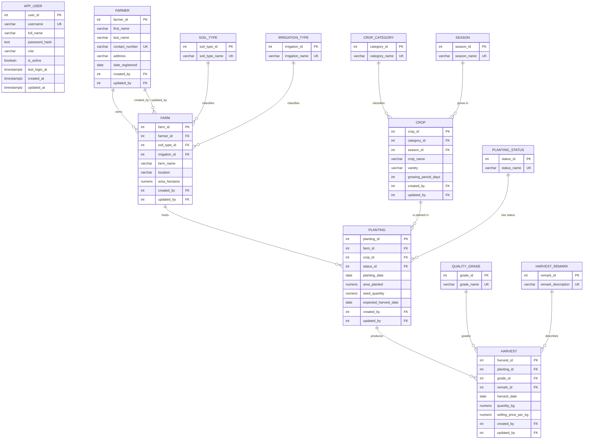

# AgriSys — Agriculture Information System

## Project Documentation

**Project:** CTU AP3 Midterm Project — Agriculture Information System
**System name:** AgriSys
**Stack:** PHP 8.1+ (PDO) · PostgreSQL 15+ (Supabase) · Bootstrap 5.3 · Chart.js
**Database:** 13 tables, 2 views, triggers and constraints, 3NF

---

## Table of contents

1. [Introduction](#1-introduction)
2. [Objectives](#2-objectives)
3. [Scope and users](#3-scope-and-users)
4. [Functional requirements traceability](#4-functional-requirements-traceability)
5. [System architecture](#5-system-architecture)
6. [Database design](#6-database-design)
7. [Normalization: UNF → 1NF → 2NF → 3NF](#7-normalization-unf--1nf--2nf--3nf)
8. [Data dictionary](#8-data-dictionary)
9. [Constraints and business rules](#9-constraints-and-business-rules)
10. [Authentication and role-based access](#10-authentication-and-role-based-access)
11. [Input validation](#11-input-validation)
12. [User interface and usability](#12-user-interface-and-usability)
13. [Testing](#13-testing)
14. [Deployment guide](#14-deployment-guide)
15. [User guide](#15-user-guide)
16. [Limitations and future work](#16-limitations-and-future-work)

---

## 1. Introduction

AgriSys is a web-based Agriculture Information System that records and monitors
the basic units of agricultural production: **farmers**, their **farms**, the
**crops** they grow, the **plantings** made on each farm, and the **harvests**
produced by each planting.

Before a system like this, the same information is usually kept in notebooks or
spreadsheets. That makes it hard to answer basic questions — how many farmers are
registered, how much land is planted, how much was harvested last month, which
crop earns the most — and it allows inconsistent values such as "Corn", "corn"
and "Maiz" to describe the same crop.

AgriSys solves this with a normalized relational database, controlled dropdown
values stored in lookup tables, server-side validation, role-based access and a
dashboard/report layer that answers those questions from live data.


---

## 2. Objectives

### General objective

Develop a complete, database-driven Agriculture Information System that stores
farm production records accurately, enforces data integrity, and presents
actionable information to administrators and field staff.

### Specific objectives

1. Design a **normalized (3NF) relational database** for farmers, farms, crops,
   plantings and harvests, with documented progression from UNF to 3NF.
2. Replace free-text categories with **lookup tables** so dropdown values are
   consistent and centrally maintained.
3. Provide **complete CRUD** for all core records, with validation and
   referential-integrity handling.
4. Implement **authentication and at least two roles** with different
   capabilities.
5. Provide a **live dashboard** and **filterable reports** that support
   day-to-day monitoring and simple decision-making.
6. Enforce **audit information** (`created_at`, `updated_at`, `created_by`,
   `updated_by`) on every stored record.
7. Deliver a **responsive, user-friendly interface** with clear success and
   error feedback.
8. Make the system **deployable on Supabase** with no code changes, only
   environment configuration.

---

## 3. Scope and users

### In scope

- Farmer registration and management
- Farm management with soil and irrigation classification
- Crop catalog with category, season and growing period
- Planting records tied to a farm and crop
- Harvest records with quality grade, remark, quantity and price
- Live dashboard and six reports (CSV export and print)
- User accounts and roles
- Lookup/reference data maintenance

### Out of scope

- Financial accounting, payroll, loans or subsidies
- Inventory of seeds/fertilizers and stock movements
- GIS mapping or satellite data
- SMS/e-mail notifications
- Mobile native applications
- Multi-organization tenancy (the system represents one agricultural office)

### Actors

| Actor | Description |
| --- | --- |
| **Administrator** | Full access. Manages users and lookup values, and is the only role allowed to delete records. |
| **Staff** | Encodes and updates operational data (farmers, farms, crops, plantings, harvests) and uses reports. Cannot delete records or open admin screens. |

---

## 4. Functional requirements traceability

| # | Requirement | Implementation | Status |
| --- | --- | --- | --- |
| F1 | Database normalized to 3NF, with UNF/1NF/2NF/3NF documentation | `database/01_schema.sql`; section 7 of this document | ✅ |
| F2 | Controlled dropdown values; labels in lookup tables and numeric ids in core tables | 7 lookup tables (`soil_type`, `irrigation_type`, `planting_status`, `crop_category`, `season`, `quality_grade`, `harvest_remark`); every form uses `SELECT` populated from them | ✅ |
| F3 | CRUD for farmers, farms, crops, plantings, harvests | `public/{farmers,farms,crops,plantings,harvests}/` each with `index`, `form`, `view`, `delete` | ✅ |
| F4 | Dashboard with at least 5 live summary cards and charts | `public/index.php`: 5 cards + 3 harvest totals + 2 Chart.js charts + 4 lists | ✅ |
| F5 | Authentication with at least 2 roles | `src/Auth.php`, `app_user.role` CHECK (`admin`, `staff`), `requireLogin()` / `requireAdmin()` | ✅ |
| F6 | Input validation on all forms | `src/Validator.php` + per-form rules; inline messages | ✅ |
| F7 | Search, filter, sort and pagination | Every `index.php`: keyword search, dropdown/date filters, sortable headers, pagination via `ITEMS_PER_PAGE` | ✅ |
| F8 | Reports with date-range filters | `public/reports.php`: 6 reports, `from`/`to` dates, optional farm/status/grade filters, CSV and print | ✅ |
| F9 | Delete confirmation and referential-integrity handling | Shared Bootstrap modal (`partials/delete-modal.php`), POST-only delete endpoints, `ON DELETE RESTRICT`, friendly error text | ✅ |
| F10 | Responsive user interface | Bootstrap 5 grid, collapsible sidebar, responsive tables/cards | ✅ |
| F11 | Success and error messages | Session flash messages (`flash()` / `take_flashes()`) rendered as dismissible alerts | ✅ |
| F12 | `created_at` / `updated_at` audit fields | Present on all 13 tables; `updated_at` maintained by trigger; core tables also store `created_by` / `updated_by` | ✅ |
| F13 | Database constraints | Primary keys, foreign keys, unique constraints, CHECK constraints, indexes, triggers | ✅ |
| F14 | Documentation | This document + `README.md` + commented SQL | ✅ |
| F15 | Testing | Lint, page smoke test (28 URLs) and 26-check integration test | ✅ |
| F16 | Supabase deployment readiness | `.env` configuration, SSL support, session-pooler guidance, SQL runs in Supabase SQL Editor | ✅ |

---

## 5. System architecture

AgriSys uses a classic three-tier structure.

```text
┌──────────────────────────────────────────────────────────────┐
│ Presentation tier (browser)                                  │
│ Bootstrap 5.3 · Bootstrap Icons · Chart.js · app.js          │
└───────────────────────────────┬──────────────────────────────┘
                                │ HTTPS (HTML forms, GET/POST)
┌───────────────────────────────▼──────────────────────────────┐
│ Application tier (PHP 8)                                     │
│ public/*.php        views/controllers (HTML only)            │
│ src/Models/*.php    models — one file per entity (all SQL)   │
│ src/Auth.php        login, roles, throttling                 │
│ src/Validator.php   validation rules                         │
│ src/helpers.php     escaping, URLs, CSRF, flash, pagination  │
│ src/Database.php    PDO wrapper, prepared statements         │
│ config/config.php   env loading, session, error handling     │
└───────────────────────────────┬──────────────────────────────┘
                                │ PDO / TLS (port 5432 session pooler)
┌───────────────────────────────▼──────────────────────────────┐
│ Data tier (Supabase PostgreSQL)                              │
│ 13 tables · 2 views · indexes · triggers · constraints       │
└──────────────────────────────────────────────────────────────┘
```

### Request flow

1. The browser requests a page under `public/`.
2. `config/config.php` loads `.env`, starts a hardened session and registers
   the error handler.
3. The page checks the session with `Auth::requireLogin()` (or
   `Auth::requireAdmin()`).
4. Input is read through `get()` / `post()` / `int_get()` / `form_id()` and
   validated inside the entity's model.
5. The page calls the model (e.g. `Farmer::save()`, `Harvest::listing()`), which
   runs prepared statements through `Database`/PDO.
6. The page sets flash messages and redirects (POST/redirect/GET), or renders
   HTML through `partials/header.php` and `partials/footer.php`.

### Models (the data-access layer)

Every entity owns a model in `src/Models/`. Pages never contain SQL — they call
the model, which returns plain arrays. `Model.php` is the shared base class
(pagination, safe ordering and a generic delete); the rest extend it.

| Model | Responsibility |
| --- | --- |
| `Model.php` | Base: `paginateQuery()`, whitelisted `orderBy()`, generic `delete()` |
| `Farmer.php` | Farmer CRUD, listing, detail, stats |
| `Farm.php` | Farm CRUD, listing, detail, `options()` for dropdowns |
| `Crop.php` | Crop CRUD, `categories()`, `seasons()`, `options()`, detail, stats |
| `Planting.php` | Planting CRUD, `listing()`, `detail()`, statuses, filter options, harvest totals |
| `Harvest.php` | Harvest CRUD, `listing()` (+ aggregate), `detail()`, grades, remarks, siblings |
| `AppUser.php` | User accounts, listing, password policy, last-admin and self-delete guards |
| `Lookup.php` | Registry of the 7 lookup tables plus add/update/delete with usage counts |
| `Dashboard.php` | Summary, status breakdown, monthly harvest, recent/upcoming/top crops |
| `Report.php` | All six report queries (farmers, farm crops, planting status, harvests, totals, value) |

Model conventions:

- `save(...)` → `['ok' => bool, 'id' => ?int, 'errors' => array, 'dbError' => ?string]`
- `delete(...)` → `['ok' => bool, 'deleted' => bool, 'error' => ?string]`
- Models never redirect and never touch flash messages; the calling page does.
- Each file starts with a `MODEL —` header comment; each page starts with a
  `VIEW —`, `VIEW / CONTROLLER —` or `CONTROLLER —` header comment.

### Database access

`Database.php` implements a small PDO wrapper:

| Method | Purpose |
| --- | --- |
| `connection()` | Creates the singleton PDO connection with `ERRMODE_EXCEPTION`, `FETCH_ASSOC`, real prepared statements and SSL mode |
| `run($sql, $params)` | Executes a statement and returns the `PDOStatement` |
| `one($sql, $params)` | Returns one row or `null` |
| `all($sql, $params)` | Returns all rows |
| `value($sql, $params, $default)` | Returns the first column of the first row |
| `count($sql, $params)` | Returns an integer count |
| `setAuditUser($id)` | Sets `agrisys.user_id` for the audit triggers |

---

## 6. Database design

### 6.1 Entity–relationship diagram



> `created_by` / `updated_by` also reference `app_user`; those edges are omitted
> from the diagram to keep it readable.

### 6.2 Entities

| Group | Tables | Purpose |
| --- | --- | --- |
| Authentication | `app_user` | Accounts, bcrypt hashes, roles, active flag |
| Lookup / reference | `soil_type`, `irrigation_type`, `planting_status`, `crop_category`, `season`, `quality_grade`, `harvest_remark` | Controlled dropdown values |
| Core | `farmer`, `farm`, `crop`, `planting`, `harvest` | Operational data |

### 6.3 Relationships and cardinality

| Relationship | Cardinality | Rule |
| --- | --- | --- |
| Farmer → Farm | 1 : N | A farm belongs to exactly one farmer; a farmer may own many farms |
| Soil type → Farm | 1 : N | Each farm has one soil type |
| Irrigation type → Farm | 1 : N | Each farm has one irrigation type |
| Farm → Planting | 1 : N | A planting happens on one farm |
| Crop → Planting | 1 : N | A planting uses one crop |
| Planting status → Planting | 1 : N | Each planting has one status |
| Crop category → Crop | 1 : N | Each crop belongs to one category |
| Season → Crop | 1 : N (optional) | A crop may be associated with a season |
| Planting → Harvest | 1 : N | A planting can be harvested several times |
| Quality grade → Harvest | 1 : N | Each harvest has one grade |
| Harvest remark → Harvest | 1 : N | Each harvest has one remark (1–5) |

### 6.4 Views

| View | Used by | Contents |
| --- | --- | --- |
| `v_planting_detail` | Planting list/detail, dashboard, reports | Planting joined with farm, farmer, crop, status |
| `v_harvest_detail` | Harvest list/detail, dashboard, reports | Harvest joined with planting, farm, farmer, crop, grade, remark and computed `estimated_value` |

Views keep the PHP readable and guarantee that list and report queries use the
same joins.

---

## 7. Normalization: UNF → 1NF → 2NF → 3NF

This section documents how the design moved from a typical spreadsheet layout to
the final 3NF schema.

### 7.1 Unnormalized form (UNF)

A farm office would typically record everything in one wide sheet. One row
represents one farmer and repeats information for every farm, crop and harvest.

**Unnormalized harvest sheet (abridged)**

| Farmer | Contact | Address | Farm | Farm size | Soil | Irrigation | Crop | Variety | Category | Season | Planting date | Area planted | Harvest 1 date / qty / price | Harvest 2 date / qty / price | Remark |
| --- | --- | --- | --- | --- | --- | --- | --- | --- | --- | --- | --- | --- | --- | --- | --- |
| Juan Dela Cruz | 0917… | Talisay | North Field | 2.50 | Clay Loam | Rainfed | Corn | Pioneer | Cereal | Wet | 2026-01-10 | 1.50 | 2026-05-01 / 4200 / 22.50 | 2026-05-04 / 1500 / 18.00 | Good Harvest |
| Juan Dela Cruz | 0917… | Talisay | Riverside | 1.20 | Loam | Drip | Tomato | Diamante | Vegetable | Dry | 2026-02-01 | 0.80 | 2026-04-20 / 900 / 25.00 | — | Acceptable Quality |

**Problems**

- **Repeating groups:** harvest columns repeat (`Harvest 1`, `Harvest 2`, …) and
  are limited to a fixed number.
- **Redundancy:** farmer, farm, crop, soil, irrigation, category and season
  descriptions repeat on every row.
- **Update anomalies:** changing a farmer's address means editing many rows and
  risks inconsistency.
- **Insert anomalies:** a farmer cannot be registered until a harvest exists.
- **Delete anomalies:** deleting the last harvest erases the farmer and farm.
- **Inconsistent values:** categories and remarks are typed by hand.
- **Derived data:** harvest value is stored, so it can disagree with
  quantity × price.

### 7.2 First normal form (1NF)

**Rule:** every column holds one atomic value and there are no repeating groups;
each row is uniquely identifiable.

Actions:

1. Split each repeated harvest into its own row.
2. Give every table a primary key.
3. Replace multi-valued text such as "Corn, Tomato" with separate rows.

**Resulting harvest rows**

| Harvest id | Farmer | Farm | Crop | Planting date | Harvest date | Qty (kg) | Price/kg |
| --- | --- | --- | --- | --- | --- | --- | --- |
| H1 | Juan Dela Cruz | North Field | Corn | 2026-01-10 | 2026-05-01 | 4200 | 22.50 |
| H2 | Juan Dela Cruz | North Field | Corn | 2026-01-10 | 2026-05-04 | 1500 | 18.00 |
| H3 | Juan Dela Cruz | Riverside | Tomato | 2026-02-01 | 2026-04-20 | 900 | 25.00 |

1NF removes repeating groups but still repeats farmer, farm, crop and lookup
labels on each harvest row.

### 7.3 Second normal form (2NF)

**Rule:** the table is in 1NF and every non-key attribute depends on the **whole**
primary key (no partial dependencies).

Conceptual harvest key: `(planting reference, harvest date)`. With that key:

- `quantity_kg`, `selling_price_per_kg` depend on the full key (a planting can be
  harvested more than once).
- `farmer name`, `contact`, `address`, `farm name`, `farm size`, `soil type`,
  `crop name`, `variety`, `category`, `season`, `planting date` and
  `area planted` depend only on the planting, not on the harvest date. They are
  **partial dependencies** and must move out.

Actions:

1. Create a **planting** entity keyed by `planting_id`, holding farm, crop,
   planting date, area, seed quantity, status and expected harvest date.
2. Keep **harvest** keyed by `harvest_id` with a foreign key to planting, holding
   only harvest-specific attributes.
3. Move descriptive lookup values (soil, irrigation, status, category, season,
   grade, remark) into dedicated tables and store only their ids.

### 7.4 Third normal form (3NF)

**Rule:** the table is in 2NF and has no transitive dependencies — every non-key
attribute depends on the key, the whole key, and nothing but the key.

Transitive dependencies removed:

| Before | Dependency chain | Resolution |
| --- | --- | --- |
| Farm row stores farmer name, contact, address | `farm_id → farmer_id → farmer details` | Keep `farmer_id` in `farm`; farmer details live in `farmer` |
| Farm row stores soil and irrigation labels | `farm_id → soil_type_id → soil_type_name` | `soil_type` and `irrigation_type` lookup tables |
| Planting row stores farm name, farmer, crop name | `planting_id → farm_id → farm/farmer` and `planting_id → crop_id → crop` | Store only `farm_id`, `crop_id`, `status_id` |
| Harvest row stores crop, farm, farmer, grade label, remark text | `harvest_id → planting_id → …` and `harvest_id → grade_id → grade_name` | Store `planting_id`, `grade_id`, `remark_id`; join through views |
| Crop row stores category and season names | `crop_id → category_id → category_name` | `crop_category` and `season` lookup tables |
| Harvest stores `estimated_value` | `harvest_id → quantity, price → value` | Not stored; computed as `quantity_kg * selling_price_per_kg` in `v_harvest_detail` |
| Unknown status/grade/remark text | free text | Foreign keys to lookup tables |

### 7.5 Final schema (3NF)

```text
app_user (user_id, username, full_name, password_hash, role, is_active, last_login_at, created_at, updated_at)

soil_type (soil_type_id, soil_type_name, created_at, updated_at)
irrigation_type (irrigation_id, irrigation_name, created_at, updated_at)
planting_status (status_id, status_name, created_at, updated_at)
crop_category (category_id, category_name, created_at, updated_at)
season (season_id, season_name, created_at, updated_at)
quality_grade (grade_id, grade_name, created_at, updated_at)
harvest_remark (remark_id, remark_description, created_at, updated_at)

farmer (farmer_id, first_name, last_name, contact_number, address, date_registered,
        created_at, updated_at, created_by, updated_by)

farm (farm_id, farmer_id, soil_type_id, irrigation_id, farm_name, location, area_hectares,
      created_at, updated_at, created_by, updated_by)

crop (crop_id, category_id, season_id, crop_name, variety, growing_period_days,
      created_at, updated_at, created_by, updated_by)

planting (planting_id, farm_id, crop_id, status_id, planting_date, area_planted,
          seed_quantity, expected_harvest_date, created_at, updated_at,
          created_by, updated_by)

harvest (harvest_id, planting_id, grade_id, remark_id, harvest_date, quantity_kg,
         selling_price_per_kg, created_at, updated_at, created_by, updated_by)
```

### 7.6 Why the result is 3NF

- **Atomic values:** all columns are scalar; there are no repeating groups.
- **Primary keys:** every table has a single-column surrogate primary key
  (`SERIAL`).
- **Full functional dependency:** no non-key attribute depends on only part of a
  key, because keys are single columns (2NF is satisfied by construction and the
  conceptual composite key was decomposed).
- **No transitive dependency:** descriptive attributes live only in the table
  that owns them; other tables reference them by id.
- **No derived attribute:** `estimated_value` is computed in a view instead of
  stored.
- **No multi-valued attribute:** a farmer with many farms has many `farm` rows; a
  planting with many harvests has many `harvest` rows.

---

## 8. Data dictionary

### 8.1 `app_user` — application accounts

| Column | Type | Constraints | Description |
| --- | --- | --- | --- |
| `user_id` | `SERIAL` | PK | Surrogate key |
| `username` | `VARCHAR(50)` | NOT NULL, UNIQUE, length ≥ 3 | Login name |
| `full_name` | `VARCHAR(120)` | NOT NULL | Display name |
| `password_hash` | `TEXT` | NOT NULL | Bcrypt hash from `password_hash()` |
| `role` | `VARCHAR(20)` | NOT NULL, default `staff`, CHECK in (`admin`,`staff`) | Access role |
| `is_active` | `BOOLEAN` | NOT NULL, default `TRUE` | Deactivated accounts cannot sign in |
| `last_login_at` | `TIMESTAMPTZ` | NULL | Updated on successful login |
| `created_at` | `TIMESTAMPTZ` | NOT NULL, default `now()` | Row creation time |
| `updated_at` | `TIMESTAMPTZ` | NOT NULL, default `now()` | Last change time (trigger) |

### 8.2 Lookup tables

Every lookup table has the same shape: a serial primary key, a unique
descriptive name, and audit timestamps maintained by the shared trigger.

| Table | Key | Label column | Values seeded |
| --- | --- | --- | --- |
| `soil_type` | `soil_type_id` | `soil_type_name` | Clay Loam, Sandy Loam, Silt Loam, Loam, Clay, Sandy, Volcanic Loam |
| `irrigation_type` | `irrigation_id` | `irrigation_name` | Rainfed, Drip Irrigation, Sprinkler, Furrow, Pump / Manual |
| `planting_status` | `status_id` | `status_name` | Planned, Planted, Growing, Ready for Harvest, Harvested, Failed |
| `crop_category` | `category_id` | `category_name` | Cereal, Vegetable, Fruit, Root Crop, Legume, Industrial Crop |
| `season` | `season_id` | `season_name` | Dry Season, Wet Season, Year-round |
| `quality_grade` | `grade_id` | `grade_name` | Grade A - Premium, Grade B - Good, Grade C - Fair, Grade D - Poor |
| `harvest_remark` | `remark_id` | `remark_description` | 1 Good Harvest, 2 Acceptable Quality, 3 Low Yield, 4 Poor Quality, 5 Damaged Harvest |

All label columns are `NOT NULL UNIQUE`; `created_at` and `updated_at` are
`TIMESTAMPTZ NOT NULL DEFAULT now()`.

### 8.3 `farmer`

| Column | Type | Constraints | Description |
| --- | --- | --- | --- |
| `farmer_id` | `SERIAL` | PK | Surrogate key |
| `first_name` | `VARCHAR(100)` | NOT NULL, no digits | Given name |
| `last_name` | `VARCHAR(100)` | NOT NULL, no digits | Family name |
| `contact_number` | `VARCHAR(30)` | NOT NULL, UNIQUE, pattern `^[0-9+\-\s()]{7,30}$` | Phone number |
| `address` | `VARCHAR(255)` | NOT NULL | Barangay / city / province |
| `date_registered` | `DATE` | NOT NULL, default `CURRENT_DATE`, ≥ 2000-01-01 | Registration date |
| `created_at` / `updated_at` | `TIMESTAMPTZ` | NOT NULL | Audit timestamps |
| `created_by` / `updated_by` | `INTEGER` | FK → `app_user`, ON DELETE SET NULL | Audit users |

### 8.4 `farm`

| Column | Type | Constraints | Description |
| --- | --- | --- | --- |
| `farm_id` | `SERIAL` | PK | Surrogate key |
| `farmer_id` | `INTEGER` | NOT NULL, FK → `farmer`, RESTRICT | Owner |
| `soil_type_id` | `INTEGER` | NOT NULL, FK → `soil_type`, RESTRICT | Soil classification |
| `irrigation_id` | `INTEGER` | NOT NULL, FK → `irrigation_type`, RESTRICT | Irrigation classification |
| `farm_name` | `VARCHAR(150)` | NOT NULL, UNIQUE with `farmer_id` | Farm label |
| `location` | `VARCHAR(255)` | NOT NULL | Where the farm is |
| `area_hectares` | `NUMERIC(10,2)` | NOT NULL, > 0 and ≤ 10,000 | Farm size in hectares |
| audit columns | | | Same pattern as `farmer` |

### 8.5 `crop`

| Column | Type | Constraints | Description |
| --- | --- | --- | --- |
| `crop_id` | `SERIAL` | PK | Surrogate key |
| `category_id` | `INTEGER` | NOT NULL, FK → `crop_category`, RESTRICT | Crop category |
| `season_id` | `INTEGER` | NULL, FK → `season`, RESTRICT | Usual season (optional) |
| `crop_name` | `VARCHAR(150)` | NOT NULL | Crop name |
| `variety` | `VARCHAR(100)` | NULL | Variety / cultivar |
| `growing_period_days` | `INTEGER` | NOT NULL, 1–3650 | Days from planting to harvest |
| audit columns | | | Same pattern as `farmer` |

A unique index on `(crop_name, COALESCE(variety, ''))` prevents duplicate
name/variety pairs.

### 8.6 `planting`

| Column | Type | Constraints | Description |
| --- | --- | --- | --- |
| `planting_id` | `SERIAL` | PK | Surrogate key |
| `farm_id` | `INTEGER` | NOT NULL, FK → `farm`, RESTRICT | Farm used |
| `crop_id` | `INTEGER` | NOT NULL, FK → `crop`, RESTRICT | Crop planted |
| `status_id` | `INTEGER` | NOT NULL, FK → `planting_status`, RESTRICT | Current status |
| `planting_date` | `DATE` | NOT NULL | Date planted |
| `area_planted` | `NUMERIC(10,2)` | NOT NULL, > 0 | Area in hectares |
| `seed_quantity` | `NUMERIC(10,2)` | NOT NULL, default 0, ≥ 0 | Seed used (kg) |
| `expected_harvest_date` | `DATE` | NULL, ≥ `planting_date` | Target harvest |
| audit columns | | | Same pattern as `farmer` |

### 8.7 `harvest`

| Column | Type | Constraints | Description |
| --- | --- | --- | --- |
| `harvest_id` | `SERIAL` | PK | Surrogate key |
| `planting_id` | `INTEGER` | NOT NULL, FK → `planting`, RESTRICT | Source planting |
| `grade_id` | `INTEGER` | NOT NULL, FK → `quality_grade`, RESTRICT | Quality classification |
| `remark_id` | `INTEGER` | NOT NULL, FK → `harvest_remark`, RESTRICT | 1–5 remark |
| `harvest_date` | `DATE` | NOT NULL, ≥ planting date (trigger) | Date harvested |
| `quantity_kg` | `NUMERIC(12,2)` | NOT NULL, > 0 and ≤ 1,000,000 | Harvest weight |
| `selling_price_per_kg` | `NUMERIC(12,2)` | NOT NULL, 0–100,000 | Price per kilogram |
| audit columns | | | Same pattern as `farmer` |

The estimated harvest value (`quantity_kg * selling_price_per_kg`) is **not**
stored; it is computed by `v_harvest_detail` and in report queries.

### 8.8 Indexes

| Index | Purpose |
| --- | --- |
| `idx_farm_farmer`, `idx_farm_soil_type`, `idx_farm_irrigation` | Speed up farm filters and joins |
| `idx_crop_category`, `idx_crop_season` | Crop filters and joins |
| `idx_planting_farm`, `idx_planting_crop`, `idx_planting_status`, `idx_planting_date` | Planting list search, filters and sorts |
| `idx_harvest_planting`, `idx_harvest_grade`, `idx_harvest_remark`, `idx_harvest_date` | Harvest joins and date-range reports |
| `uq_farm_farmer_name` | One farm name per farmer |
| `uq_crop_name_variety` | No duplicate crop/variety pairs |

---

## 9. Constraints and business rules

### 9.1 Declarative constraints

| Type | Examples |
| --- | --- |
| Primary keys | `farmer_id`, `farm_id`, `crop_id`, `planting_id`, `harvest_id`, `user_id` |
| Foreign keys | `farm.farmer_id → farmer`, `planting.farm_id → farm`, `harvest.planting_id → planting`, lookup ids |
| Unique | `app_user.username`, `farmer.contact_number`, lookup labels, `(farmer_id, farm_name)`, `(crop_name, COALESCE(variety,''))` |
| CHECK | valid role, positive farm/planting area, non-negative seed, growing period 1–3650, harvest quantity/price ranges, valid contact pattern, no digits in names, registration date ≥ 2000-01-01 |

### 9.2 Referential actions

| Relationship | Action | Effect |
| --- | --- | --- |
| Core record → lookup value | `ON DELETE RESTRICT` | A soil type, status, grade or remark that is in use cannot be deleted |
| Farmer → farm | `ON DELETE RESTRICT` | A farmer with farms cannot be deleted |
| Farm → planting | `ON DELETE RESTRICT` | A farm with plantings cannot be deleted |
| Crop → planting | `ON DELETE RESTRICT` | A crop used by a planting cannot be deleted |
| Planting → harvest | `ON DELETE RESTRICT` | A planting with harvests cannot be deleted |
| `created_by` / `updated_by` → `app_user` | `ON DELETE SET NULL` | Deleting a user never destroys core records |

The application catches PostgreSQL SQLSTATE `23503`/`23001` and shows:
*"This record is still used by other records, so it cannot be deleted. Remove
the related records first."*

### 9.3 Trigger-enforced rules

| Trigger | Table | Rule |
| --- | --- | --- |
| `trg_planting_validate` | `planting` | `area_planted` cannot exceed the farm's `area_hectares`; expected harvest cannot precede planting |
| `trg_farm_validate` | `farm` | Farm size cannot be reduced below the total area already planted |
| `trg_harvest_validate` | `harvest` | Harvest date cannot precede the planting date |
| `trg_*_updated_at` | all tables | Sets `updated_at = now()` on every update |
| `trg_*_audit` | core tables | Sets `updated_by` (and `created_by` on insert) from the session user |

The same rules are also checked in PHP so users get inline messages before the
database raises an exception.

### 9.4 Application-level deletion rules

- Delete is a **POST** request with a CSRF token.
- Only the `admin` role may delete.
- A confirmation modal shows the record name before submission.
- A failed delete leaves the record untouched and reports why.

Example safe delete order to remove a farmer completely:
harvest → planting → farm → farmer.

---

## 10. Authentication and role-based access

### 10.1 Login flow

1. The user submits username and password with a CSRF token.
2. `Auth::attempt()` looks up the account by lower-cased username.
3. Inactive accounts and wrong passwords fail identically ("Invalid username or
   password") to avoid revealing which part was wrong.
4. On success the session id is regenerated, user details are stored in the
   session, and `last_login_at` is updated.
5. Five consecutive failures lock login attempts for 60 seconds.

### 10.2 Password storage

- Creation and password changes use `password_hash($password, PASSWORD_DEFAULT)`
  (bcrypt).
- Verification uses `password_verify()`.
- Demo hashes are baked into `02_seed.sql`; the plain-text demo passwords are
  documented only for evaluation.

### 10.3 Authorization

| Guard | Used by | Behaviour when it fails |
| --- | --- | --- |
| `Auth::requireLogin()` | all application pages | Redirect to `login.php` with a flash message |
| `Auth::requireAdmin()` | `users/*`, `lookups.php` | HTTP 403 page/redirect with "not allowed" message |
| Role check in `delete.php` | every delete endpoint | 403 + flash, record preserved |

### 10.4 Session and CSRF

- Session name `agrisys_session`; `HttpOnly`, `SameSite=Lax`, `Secure` on HTTPS.
- A 64-character CSRF token is stored in the session and rendered in every form.
- `verify_csrf()` compares with `hash_equals()` and aborts invalid submissions
  with HTTP 419 and a friendly message.

---

## 11. Input validation

Validation is implemented in `src/Validator.php` and invoked inside each entity's
model (`src/Models/*.php`) during `save()`. The database repeats critical checks
as constraints/triggers, so invalid data cannot enter through another path.

| Form | Main rules |
| --- | --- |
| **Farmer** | First/last name required, ≤ 100 chars, letters/spaces/apostrophes/hyphens only; contact required, 7–30 chars, unique, valid phone pattern; address required, ≤ 255; date required, valid, not in the future |
| **Farm** | Farmer, soil type and irrigation must exist; name required, ≤ 150, unique per farmer; location required, ≤ 255; area numeric 0.01–10,000 |
| **Crop** | Category must exist; name required, ≤ 150; variety ≤ 100; growing period integer 1–3650; optional season must exist; name + variety unique |
| **Planting** | Farm, crop and status must exist; planting date valid and at most 2 years ahead; area 0.01–10,000 and ≤ farm size; seed ≥ 0; expected harvest valid, ≥ planting date and within 5 years |
| **Harvest** | Planting, grade and remark must exist; harvest date valid, not in the future, ≥ planting date; planting must not be "Failed"; quantity 0.01–1,000,000; price 0–100,000 |
| **User** | Username 3–50, allowed characters, unique; full name 3–120; role admin/staff; password ≥ 8 chars with a letter and a number, confirmation must match; cannot demote/deactivate the last active admin or deactivate yourself |
| **Lookup** | Name required, ≤ 255, unique within its table; cannot delete an in-use value |

Error messages appear next to the field, the form keeps the submitted values,
and `aria-invalid` / `is-invalid` classes highlight the problem.

---

## 12. User interface and usability

### 12.1 Layout

- Fixed sidebar (desktop) that collapses into an off-canvas menu (mobile).
- Top bar with page title, primary actions and the account menu.
- Success and error flash messages as dismissible Bootstrap alerts.
- Cards, responsive tables and badges for statuses.
- Empty states explain what to do when a list has no rows.

### 12.2 Navigation

| Menu | Pages |
| --- | --- |
| Dashboard | Live overview |
| Farmers | List, add, edit, detail |
| Farms | List, add, edit, detail |
| Crops | List, add, edit, detail |
| Plantings | List, add, edit, detail |
| Harvests | List, add, edit, detail |
| Reports | 6 report types |
| Administration | User accounts, lookup values (admin only) |

### 12.3 List features

- **Search** across the fields users actually know (names, farm, crop).
- **Filters** relevant to the module (status, farm, crop, date range, grade).
- **Sorting** by clicking column headers; whitelisted columns and directions
  only.
- **Pagination** with page links; `ITEMS_PER_PAGE` defaults to 10.
- Filters, search and sort are preserved when changing pages.

### 12.4 Feedback

| Situation | Feedback |
| --- | --- |
| Record created/updated | Green alert ("Farmer registered successfully.") |
| Validation error | Red field messages + summary remains on the form |
| Delete blocked | Red alert explaining that related records must be removed first |
| Unauthorized access | Redirect with a warning |
| Database unavailable | Friendly configuration message; details only in the log |

### 12.5 Dashboard content

- 5 summary cards: farmers, farms (with total area), crops, plantings (with
  active count), harvests (with total quantity).
- Harvest totals: total quantity, estimated value, average price per kg.
- **Chart 1:** plantings by status (doughnut).
- **Chart 2:** harvest volume for the last six months (bar/line).
- Lists: recent plantings, recent harvests, upcoming harvests (next 30 days) and
  top crops by harvested quantity.

---

## 13. Testing

### 13.1 Environment

| Item | Value |
| --- | --- |
| PHP | 8.2 (built-in server) |
| Database | PostgreSQL 18 local instance with the Supabase-compatible schema |
| Browser client | PowerShell `Invoke-WebRequest` session (cookies + CSRF) |
| Data | `02_seed.sql` demo data plus records created by the test |

### 13.2 Static checks

| Check | Result |
| --- | --- |
| `php -l` on all 46 PHP files | ✅ No syntax errors |
| SQL schema executed on a fresh PostgreSQL 18 database | ✅ 13 tables, 2 views created |
| Seed executed | ✅ 8 farmers, 10 farms, 8 crops, 13 plantings, 10 harvests, 2 users |

### 13.3 Page smoke test (28 URLs)

Dashboard, both create/edit forms and detail pages for all five modules, all six
reports, CSV export, user accounts, user edit and lookup pages returned
**HTTP 200** with no PHP warning/error text. Login redirected to the dashboard
and logout returned to the login page.

### 13.4 Integration test matrix (26 checks)

Reproduce with `tests/crud.ps1` (see `tests/README.md`); the page smoke test is
`tests/smoke.ps1`.

| # | Test case | Expected | Result |
| --- | --- | --- | --- |
| 1 | Submit farmer form with empty names, invalid contact/date | Validation messages shown, nothing saved | PASS |
| 2 | Create a valid farmer | Record saved, success message | PASS |
| 3 | Create another farmer with the same contact number | Duplicate rejected | PASS |
| 4 | Create a farm for the new farmer | Record saved | PASS |
| 5 | Duplicate farm name for the same farmer | Rejected | PASS |
| 6 | Create a crop | Record saved | PASS |
| 7 | Planting area larger than farm size | Rejected with area message | PASS |
| 8 | Expected harvest before planting date | Rejected | PASS |
| 9 | Create a valid planting | Record saved | PASS |
| 10 | Harvest date before planting date | Rejected | PASS |
| 11 | Create a valid harvest | Record saved | PASS |
| 12 | Estimated value = quantity × price | 100 × 10 = 1,000 shown | PASS |
| 13 | Delete a farmer who still has farms | Blocked, record remains, friendly message | PASS |
| 14 | Delete a planting that still has harvests | Blocked, record remains | PASS |
| 15 | Update the farmer | Changes saved | PASS |
| 16 | Delete the test chain (harvest → planting → farm → farmer) | All test records removed | PASS |
| 17 | Add a lookup value | Created | PASS |
| 18 | Rename a lookup value | Updated | PASS |
| 19 | Delete an unused lookup value | Removed | PASS |
| 20 | Delete a lookup value that is in use | Blocked, friendly message | PASS |
| 21 | Export a report as CSV | `text/csv` with BOM and expected title | PASS |
| 22 | Harvest value report renders totals | Expected total present | PASS |
| 23 | Staff opens user accounts | Blocked | PASS |
| 24 | Staff lists farmers | Allowed, no delete buttons | PASS |
| 25 | Staff posts to a delete endpoint | Blocked, record remains | PASS |
| 26 | Login with a wrong password | Rejected | PASS |

**Summary:** 26 of 26 integration checks passed; 28 of 28 pages returned 200.

### 13.5 Manual checks performed

- Login, logout and session persistence across pages.
- Flash messages survive the POST/redirect/GET cycle and disappear on reload.
- Delete modal opens with the correct record name and URL.
- Report filters, CSV download, and print layout.
- Lookup changes immediately appear in the related dropdowns.
- Deactivated account cannot sign in.

### 13.6 Known test limitations

- No automated cross-browser or real-device test was run; responsiveness is
  implemented with Bootstrap breakpoints.
- Concurrency/load testing was not performed (single-office scale assumed).

---

## 14. Deployment guide

### 14.1 Supabase (database)

1. Create a project at <https://supabase.com/dashboard>.
2. Open **SQL Editor**, run `database/01_schema.sql`, then
   `database/02_seed.sql`.
3. Copy the **Session pooler** connection settings from
   **Project Settings → Database**.
4. Fill in `.env`:

   ```dotenv
   DB_HOST=aws-0-region.pooler.supabase.com
   DB_PORT=5432
   DB_NAME=postgres
   DB_USER=postgres.projectref
   DB_PASSWORD=your-password
   DB_SSLMODE=require
   APP_BASE_URL=
   APP_TIMEZONE=Asia/Manila
   ITEMS_PER_PAGE=10
   ```

5. Change the demo passwords via **User Accounts** after the first login.

> The transaction pooler (port 6543) is **not** recommended: audit triggers use a
> session variable and the application uses prepared statements.

### 14.2 Application (PHP host)

1. Upload the project, keeping `config/`, `src/`, `database/` and `.env` outside
   the web root.
2. Set the document root to `public/`.
3. Ensure PHP ≥ 8.1 with `pdo_pgsql`, `mbstring` and `openssl`.
4. Create `.env` on the server with production values.
5. Make `storage/logs/` writable by the web server.
6. Enable HTTPS so session cookies are marked `Secure`.

**Local development:**

```bash
php -S localhost:8000 -t public
```

### 14.3 Post-deployment checklist

- [ ] Login as admin works and `storage/logs/app.log` has no errors.
- [ ] Dashboard counts match the database.
- [ ] Each module lists, creates, edits and views records.
- [ ] Delete is blocked for in-use records and works for unreferenced ones.
- [ ] Reports render, export CSV and print.
- [ ] Staff account cannot delete or open admin pages.
- [ ] Demo passwords changed.

---

## 15. User guide

### 15.1 Sign in

1. Open the application URL.
2. Enter your username and password.
3. Click **Sign in**. The dashboard opens.

If you fail five times in a row, wait 60 seconds before trying again.

### 15.2 Dashboard

The dashboard is read-only. Use the cards and **Open module** links to jump to a
list, or use the sidebar.

### 15.3 Add a farmer

1. Open **Farmers → Add farmer**.
2. Enter first name, last name, contact number, address and registration date.
3. Click **Save farmer**. The new farmer's detail page opens with a success
   message.

### 15.4 Add a farm

1. Open **Farms → Add farm**.
2. Choose the farmer, soil type and irrigation type from the dropdowns.
3. Enter the farm name, location and size in hectares.
4. Save.

The farm size cannot be smaller than the total area already planted on that
farm.

### 15.5 Add a crop

1. Open **Crops → Add crop**.
2. Choose a category and (optionally) a season.
3. Enter the crop name, variety and growing period in days.
4. Save. The same name + variety cannot be entered twice.

### 15.6 Add a planting

1. Open **Plantings → Add planting** (or use **New planting** on the
   dashboard).
2. Choose the farm, crop and status.
3. Enter the planting date, area planted, seed quantity and expected harvest
   date.
4. Save. The planted area cannot exceed the farm size.

### 15.7 Add a harvest

1. Open **Harvests → Add harvest**.
2. Choose the planting, quality grade and remark (1–5).
3. Enter the harvest date, quantity in kilograms and selling price per kg.
4. Save. The estimated value appears automatically on lists and reports.

### 15.8 Search, filter, sort and paginate

- Type in the search box and click **Filter**.
- Use the dropdowns/date fields to narrow the list.
- Click a column heading to sort; click again to reverse.
- Use the page links at the bottom to move between pages.
- Click **Reset** to clear filters.

### 15.9 View, edit and delete

- Click the **eye** icon on a row to open the detail page.
- Click the **pencil** icon to change a record.
- Click the **trash** icon (admin only), read the confirmation, then confirm.
- If the record is used by other records, the system refuses to delete it and
  explains what to remove first.

### 15.10 Reports

1. Open **Reports**.
2. Choose a report from the left/top list.
3. Set the **From** and **To** dates and any optional filter.
4. Click **Apply**.
5. Use **Export CSV** to download the data or **Print** for a paper copy.

### 15.11 Manage users (admin)

1. Open **User Accounts**.
2. Click **New account** or the pencil icon.
3. Set username, full name, role and status.
4. Enter a password (at least 8 characters, with a letter and a number) and
   confirm it.
5. Save. The last active administrator cannot be demoted or deactivated.

### 15.12 Manage lookup values (admin)

1. Open **Lookup Tables**.
2. Pick the table (soil types, irrigation, statuses, categories, seasons,
   grades, harvest remarks).
3. Add, rename or delete a value.
4. Values that are still used by records cannot be deleted or renamed to a
   duplicate. Changes appear immediately in the related forms.

### 15.13 Sign out

Open the account menu at the top right and choose **Sign out**.

---

## 16. Limitations and future work

### Current limitations

- Single-office deployment; no multi-tenant separation.
- No file attachments (e.g. photos, receipts).
- No e-mail/SMS notifications for upcoming harvests.
- Reports are fixed; users cannot build custom queries.
- English-only interface.
- No automated cross-browser/device test suite.

### Possible enhancements

- Yield-per-hectare analytics and year-over-year comparisons.
- Weather integration for planting advice.
- Seed/fertilizer inventory with stock movements.
- Farmer portal with read-only access to their own records.
- PDF report templates and scheduled e-mail reports.
- Audit trail table recording every change (currently only last editor).
- Two-factor authentication for administrators.
- REST API for mobile clients.

---

## Appendix A — Demo data summary

| Table | Rows |
| --- | --- |
| `app_user` | 2 (`admin`, `staff`) |
| `farmer` | 8 |
| `farm` | 10 |
| `crop` | 8 |
| `planting` | 13 |
| `harvest` | 10 |
| `soil_type` | 7 |
| `irrigation_type` | 5 |
| `planting_status` | 6 |
| `crop_category` | 6 |
| `season` | 3 |
| `quality_grade` | 4 |
| `harvest_remark` | 5 (ids 1–5) |

## Appendix B — File map

| Path | Responsibility |
| --- | --- |
| `config/config.php` | Bootstrap: env, errors, session, constants |
| `src/Database.php` | PDO wrapper |
| `src/Auth.php` | Login, roles, throttling |
| `src/Validator.php` | Validation rules |
| `src/helpers.php` | Escaping, URLs, CSRF, flash, pagination, formatting |
| `src/Models/Model.php` | Base model: pagination, ordering, generic delete |
| `src/Models/Farmer.php` | Farmer model (CRUD + queries) |
| `src/Models/Farm.php` | Farm model (CRUD + dropdown options) |
| `src/Models/Crop.php` | Crop model (CRUD + categories/seasons/options) |
| `src/Models/Planting.php` | Planting model (CRUD + listing, statuses, filters) |
| `src/Models/Harvest.php` | Harvest model (CRUD + listing, grades, remarks) |
| `src/Models/AppUser.php` | User-account model (+ last-admin/self-delete guards) |
| `src/Models/Lookup.php` | Lookup-table registry + add/update/delete |
| `src/Models/Dashboard.php` | Dashboard queries |
| `src/Models/Report.php` | Report queries |
| `public/index.php` | Dashboard view |
| `public/reports.php` | Reports view, CSV, print |
| `public/lookups.php` | Lookup maintenance view (admin) |
| `public/*/index.php` | List views with search/filter/sort/pagination |
| `public/*/form.php` | Shared create/edit view |
| `public/*/view.php` | Detail view |
| `public/*/delete.php` | POST-only delete controller |
| `public/users/` | Account management (admin) |
| `public/partials/` | Header, footer, delete modal |
| `database/01_schema.sql` | DDL, triggers, views, indexes |
| `database/02_seed.sql` | Lookup values, demo data, demo users |
